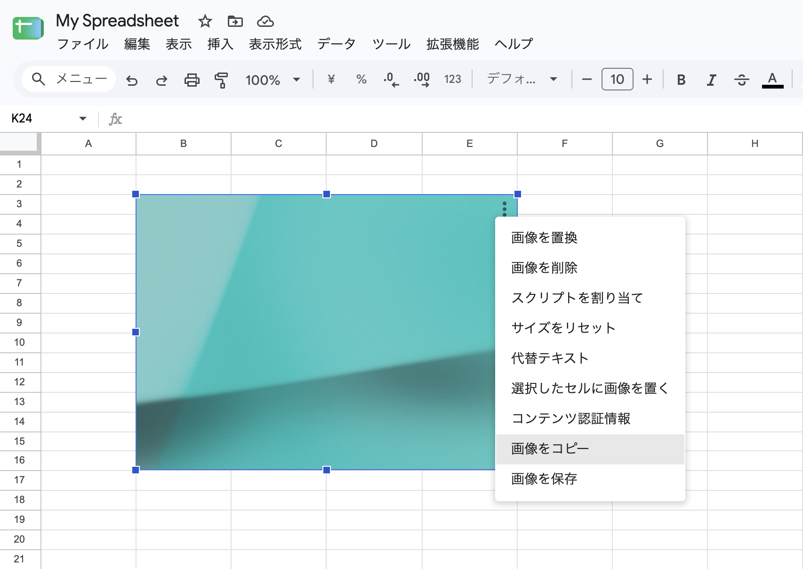

# Google Sheets Image Copier

[English](README.md) | 日本語 | [한국어](README.ko.md) | [简体中文](README.zh-CN.md) | [繁體中文](README.zh-TW.md)

Google スプレッドシートの画像メニューに、次の操作を追加する Chrome・Firefox 向けの拡張機能です。

- `画像をコピー`
- `画像を保存`

セルの上に配置された画像が対象です。



表示言語は Google スプレッドシートの `html[lang]` に従います。`ja` は日本語、`ko` とその地域別の値は韓国語、`zh-CN` は中国語（簡体字）、`zh-TW`、`zh-HK`、`zh-MO`、`zh-Hant` とその地域別の値は中国語（繁体字）で表示します。それ以外は英語で表示します。

Chrome 121 以降または Firefox 127 以降が必要です。ビルドやコマンドの実行は不要です。

## ローカルへのインストール

### Chrome

1. `chrome://extensions` を開きます。
2. デベロッパーモードを有効にします。
3. 「パッケージ化されていない拡張機能を読み込む」をクリックします。
4. このディレクトリを選択します。
5. 拡張機能のファイルを編集した後は、拡張機能の再読み込みボタンをクリックし、開いている Google スプレッドシートのタブも再読み込みします。

### Firefox

1. `about:debugging#/runtime/this-firefox` を開きます。
2. 「一時的なアドオンを読み込む」をクリックし、`firefox/manifest.json` を選択します。
3. 拡張機能のファイルを編集した後は、アドオンと Google スプレッドシートのタブを再読み込みします。

一時的なアドオンは Firefox の終了時に削除されるため、再起動後は再度読み込んでください。

## 動作の仕組み

`firefox` ディレクトリには、Firefox 用のマニフェストと共通ファイルのコピーがあります。共通ファイルを変更するときは、両方を更新してください。

コンテンツスクリプトは `manifest.json` に記載された順に読み込まれます。`constants.js` は共通の設定、`i18n.js` は翻訳文言、`utils.js` は画像と DOM の補助処理を持ち、`content.js` はメニューの検出と操作を担当します。

`content.js` は Google スプレッドシートのメニューを監視し、埋め込み画像のオプションメニューに見える場合に、コピーと保存の項目を追加します。操作時には、次のセレクターに一致するフォーカス中のオーバーレイから画像を特定します。

```text
[id$='-focused-overlay-container'] > :is(.overlay-container-ltr, .overlay-container-rtl).focused-overlay-container > .waffle-borderless-embedded-object-overlay.waffle-borderless-embedded-object-overlay-focused
```

複数の画像を選択している場合、Google スプレッドシートは単一画像用のメニューを表示しないため、拡張機能は操作を実行しません。

画像の選択・選択解除後も、Google スプレッドシートにフォーカス済みクラスを持つ重複したオーバーレイや古いオーバーレイが残ることがあります。拡張機能は `*-focused-overlay-container` の外にあるオーバーレイを無視し、その中に表示中のオーバーレイが一つだけある場合に、その画像を操作対象にします。

コピーにはブラウザーの Clipboard API を使います。保存時はコンテンツスクリプトで選択画像をデータ URL に変換し、`background.js` から `chrome.downloads.download()` を呼び出します。
