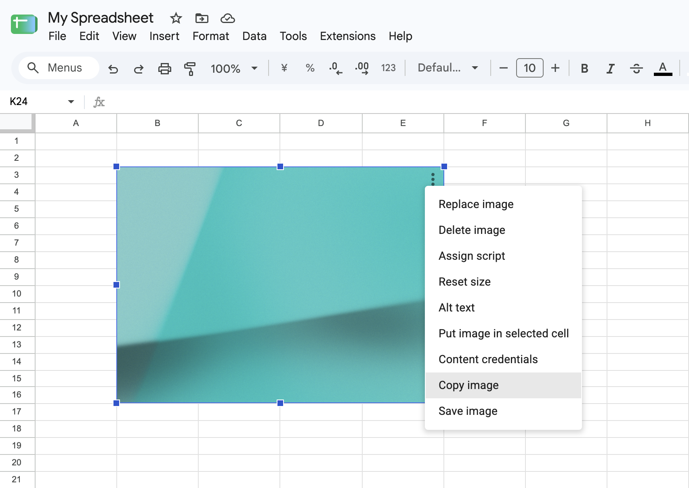

# Google Sheets Image Copier

[English](README.md) | [日本語](README.ja.md) | 한국어 | [简体中文](README.zh-CN.md) | [繁體中文](README.zh-TW.md)

Google 스프레드시트의 이미지 옵션 메뉴에 다음 두 가지 작업을 추가하는 Chrome 확장 프로그램입니다.

- `이미지 복사`
- `이미지 저장`

셀 위에 배치된 이미지만 지원합니다.



표시 언어는 Google 스프레드시트의 `html[lang]`을 따릅니다. `ja`는 일본어, `ko`와 그 지역별 값은 한국어, `zh-CN`은 중국어 간체, `zh-TW`, `zh-HK`, `zh-MO`, `zh-Hant`와 그 지역별 값은 중국어 번체로 표시됩니다. 그 밖의 언어는 영어로 표시됩니다.

빌드할 필요가 없습니다. Chrome 확장 프로그램 설정에서 이 디렉터리를 직접 불러오면 됩니다.

## 로컬 설치

1. `chrome://extensions`를 엽니다.
2. 개발자 모드를 켭니다.
3. 「압축해제된 확장 프로그램을 로드합니다」를 클릭합니다.
4. 이 디렉터리를 선택합니다.
5. 확장 프로그램 파일을 수정한 후에는 확장 프로그램의 새로고침 버튼을 클릭하고, 열려 있는 Google 스프레드시트 탭도 새로고침합니다.

## 작동 방식

콘텐츠 스크립트는 `manifest.json`에 나열된 순서대로 로드됩니다. `constants.js`는 공통 설정, `i18n.js`는 번역 문구, `utils.js`는 이미지와 DOM 보조 함수를 제공하며, `content.js`는 메뉴 감지와 작업 실행을 담당합니다.

`content.js`는 Google 스프레드시트 메뉴를 감시하고, 열린 메뉴가 삽입된 이미지의 옵션 메뉴로 보이면 복사와 저장 항목을 추가합니다. 작업을 클릭하면 활성 포커스 오버레이 컨테이너 안에서 다음 선택자에 일치하는 오버레이를 찾아 선택된 이미지를 식별합니다.

```text
[id$='-focused-overlay-container'] > :is(.overlay-container-ltr, .overlay-container-rtl).focused-overlay-container > .waffle-borderless-embedded-object-overlay.waffle-borderless-embedded-object-overlay-focused
```

이미지를 여러 개 선택한 경우 Google 스프레드시트가 단일 이미지 메뉴를 표시하지 않으므로 확장 프로그램도 작업을 실행하지 않습니다.

이미지를 선택하거나 선택 해제한 후에도 Google 스프레드시트에 포커스 클래스가 있는 중복되거나 오래된 오버레이가 남을 수 있습니다. 확장 프로그램은 `*-focused-overlay-container` 바깥의 오버레이를 무시하고, 그 안에 표시된 포커스 오버레이가 하나일 때만 해당 이미지를 작업 대상으로 삼습니다.

복사에는 브라우저의 Clipboard API를 사용합니다. 저장할 때는 콘텐츠 스크립트에서 선택한 이미지를 데이터 URL로 변환하고, `background.js`에서 `chrome.downloads.download()`를 호출합니다.
