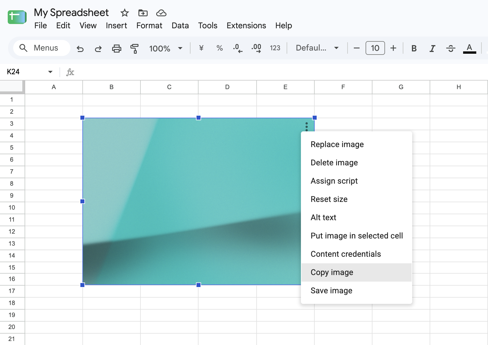

# Google Sheets Image Copier

English | [日本語](README.ja.md) | [한국어](README.ko.md) | [简体中文](README.zh-CN.md) | [繁體中文](README.zh-TW.md)

Chrome extension that adds two actions to the image options menu in Google Sheets:

- `Copy image`
- `Save image`

It supports only images placed over cells.



The labels follow Google Sheets' `html[lang]`: Japanese for `ja`, Korean for `ko` and its regional variants, Simplified Chinese for `zh-CN`, Traditional Chinese for `zh-TW`, `zh-HK`, `zh-MO`, and `zh-Hant` variants, and English for every other language.

The extension is intentionally build-free. Load this directory directly from Chrome's extension settings.

## Install for local use

1. Open `chrome://extensions`.
2. Enable developer mode.
3. Click `Load unpacked`.
4. Select this directory.
5. After editing extension files, click the extension's reload button and reload the open Google Sheets tab.

## How it works

The content scripts load in the order listed in `manifest.json`: `constants.js` defines shared settings, `i18n.js` provides localized text, `utils.js` contains image and DOM helpers, and `content.js` handles menu detection and actions.

`content.js` watches Google Sheets menus and appends the two image actions when the open menu looks like the embedded-image options menu. The selected image is identified at click time from the focused overlay under the active focused overlay container:

```text
[id$='-focused-overlay-container'] > :is(.overlay-container-ltr, .overlay-container-rtl).focused-overlay-container > .waffle-borderless-embedded-object-overlay.waffle-borderless-embedded-object-overlay-focused
```

When multiple images are selected, the extension does not run an action because Google Sheets does not show the single-image menu in that state.

Google Sheets can keep duplicate or stale overlays with the focused class after an image is selected or deselected. The extension ignores focused overlays outside the `*-focused-overlay-container` tree, then treats only one visible focused overlay inside that tree as the actionable image.

Copy uses the browser Clipboard API from the clicked menu item. Save resolves the selected image to a data URL in the content scripts and lets `background.js` call `chrome.downloads.download()`.
