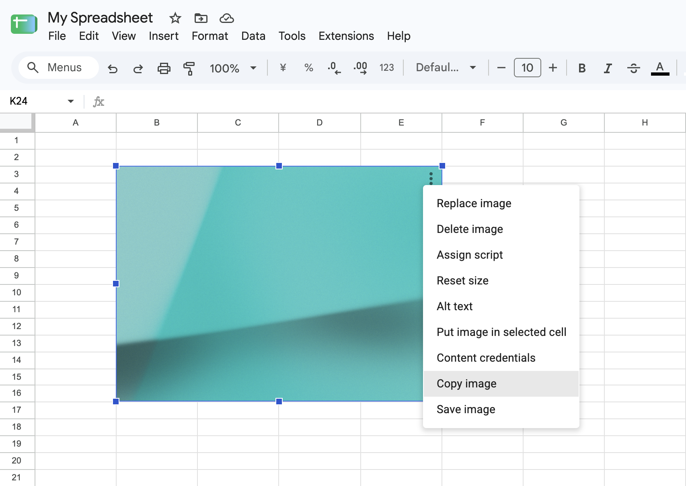

# Google Sheets Image Copier

[English](README.md) | [日本語](README.ja.md) | [한국어](README.ko.md) | 简体中文 | [繁體中文](README.zh-TW.md)

这个 Chrome 扩展程序会在 Google 表格的图片选项菜单中添加两个操作：

- `复制图片`
- `保存图片`

仅支持放置在单元格上方的图片。



显示语言由 Google 表格的 `html[lang]` 决定：`ja` 显示日语，`ko` 及其地区变体显示韩语，`zh-CN` 显示简体中文，`zh-TW`、`zh-HK`、`zh-MO`、`zh-Hant` 及其地区变体显示繁体中文，其他语言显示英语。

无需构建，可直接在 Chrome 扩展程序设置中加载此目录。

## 本地安装

1. 打开 `chrome://extensions`。
2. 启用开发者模式。
3. 点击「加载已解压的扩展程序」。
4. 选择此目录。
5. 修改扩展程序文件后，点击扩展程序的重新加载按钮，并重新加载已打开的 Google 表格标签页。

## 工作原理

内容脚本按 `manifest.json` 中列出的顺序加载：`constants.js` 定义共享设置，`i18n.js` 提供翻译文本，`utils.js` 包含图片和 DOM 辅助函数，`content.js` 负责检测菜单和执行操作。

`content.js` 监视 Google 表格菜单；当打开的菜单看起来是嵌入图片的选项菜单时，就会添加复制和保存操作。点击操作时，扩展程序会在活动的焦点覆盖层容器中通过以下选择器找到覆盖层，进而确定选中的图片：

```text
[id$='-focused-overlay-container'] > :is(.overlay-container-ltr, .overlay-container-rtl).focused-overlay-container > .waffle-borderless-embedded-object-overlay.waffle-borderless-embedded-object-overlay-focused
```

选择多张图片时，Google 表格不会显示单张图片的菜单，因此扩展程序不会执行操作。

选择或取消选择图片后，Google 表格可能会留下带有焦点类的重复或过期覆盖层。扩展程序会忽略 `*-focused-overlay-container` 外的覆盖层，仅当容器内恰好有一个可见的焦点覆盖层时，才将其图片作为操作对象。

复制操作使用浏览器的 Clipboard API。保存操作由内容脚本将选中的图片转换为数据 URL，再由 `background.js` 调用 `chrome.downloads.download()`。
