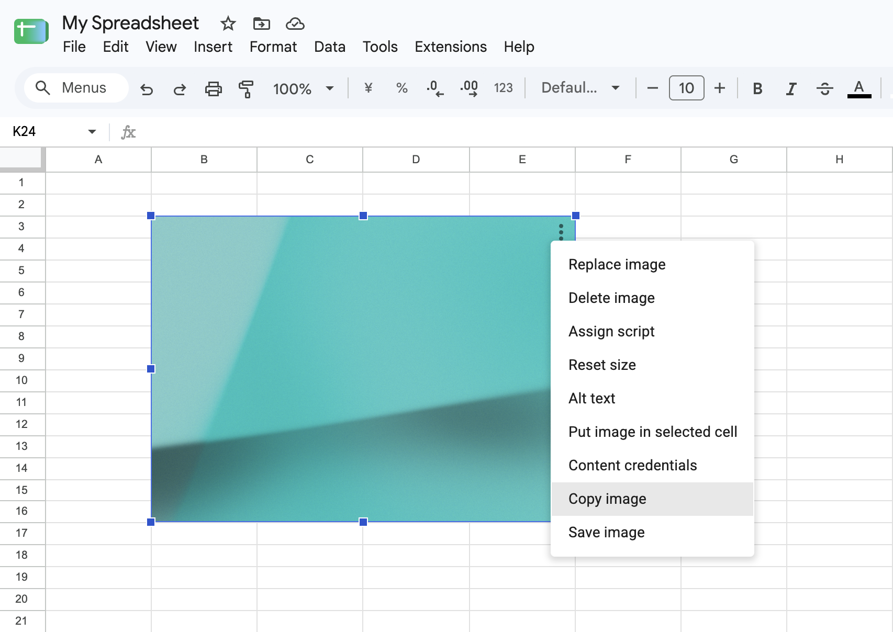

# Google Sheets Image Copier

[English](README.md) | [日本語](README.ja.md) | [한국어](README.ko.md) | [简体中文](README.zh-CN.md) | 繁體中文

這個 Chrome 擴充功能會在 Google 試算表的圖片選項選單中加入兩個操作：

- `複製圖片`
- `儲存圖片`

僅支援放置在儲存格上方的圖片。



顯示語言由 Google 試算表的 `html[lang]` 決定：`ja` 顯示日文，`ko` 及其地區變體顯示韓文，`zh-CN` 顯示簡體中文，`zh-TW`、`zh-HK`、`zh-MO`、`zh-Hant` 及其地區變體顯示繁體中文，其他語言顯示英文。

不需要建置，可直接在 Chrome 擴充功能設定中載入此目錄。

## 本機安裝

1. 開啟 `chrome://extensions`。
2. 啟用開發人員模式。
3. 按一下「載入未封裝項目」。
4. 選取此目錄。
5. 修改擴充功能檔案後，按一下擴充功能的重新載入按鈕，並重新載入已開啟的 Google 試算表分頁。

## 運作方式

內容指令碼會依照 `manifest.json` 中列出的順序載入：`constants.js` 定義共用設定，`i18n.js` 提供翻譯文字，`utils.js` 包含圖片和 DOM 輔助函式，`content.js` 負責偵測選單及執行操作。

`content.js` 會監視 Google 試算表選單；當開啟的選單看起來是嵌入圖片的選項選單時，就會加入複製和儲存操作。點選操作時，擴充功能會在作用中的焦點覆蓋層容器內，透過以下選擇器找到覆蓋層，進而辨識選取的圖片：

```text
[id$='-focused-overlay-container'] > :is(.overlay-container-ltr, .overlay-container-rtl).focused-overlay-container > .waffle-borderless-embedded-object-overlay.waffle-borderless-embedded-object-overlay-focused
```

選取多張圖片時，Google 試算表不會顯示單張圖片的選單，因此擴充功能不會執行操作。

選取或取消選取圖片後，Google 試算表可能會留下帶有焦點類別的重複或過期覆蓋層。擴充功能會忽略 `*-focused-overlay-container` 外的覆蓋層，只有在容器內恰好有一個可見的焦點覆蓋層時，才會將其圖片作為操作對象。

複製操作使用瀏覽器的 Clipboard API。儲存操作由內容指令碼將選取的圖片轉換成資料 URL，再由 `background.js` 呼叫 `chrome.downloads.download()`。
